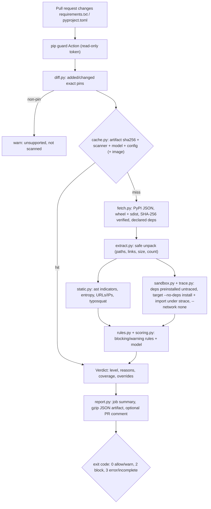

# pip guard

[](https://github.com/Aditi1968/Pip-guard/actions/workflows/ci.yml)

**Airport security for the code your project downloads.** pip guard is a CI gate that judges a Python dependency by what it does, not only by whether someone has already reported it.

When a pull request adds or changes a pinned direct dependency, pip guard does the following:

1. Downloads the exact artifact and verifies its hash.
2. Extracts it safely and analyses it statically.
3. Installs and imports it in a disposable, network-less container while tracing its system calls.
4. Scores the evidence.
5. Fails the GitHub check with readable reasons when the package looks malicious.

It runs entirely inside GitHub Actions and is built and operated for $0 ([`docs/COSTS.md`](docs/COSTS.md)).

> Status: v0.1 in progress. Scope and requirements: [`docs/PRD.md`](docs/PRD.md). How it fits together: [`docs/DESIGN.md`](docs/DESIGN.md). Build log for newcomers: [`docs/log/00-overview.md`](docs/log/00-overview.md).

## Why

Anyone can publish to PyPI, and installed code runs with the full trust of your project. Scanners such as pip-audit, Dependabot and Snyk match names and versions against databases of reported incidents, so the first victims of a new attack are unprotected. pip guard complements them: it looks at behaviour (credential files opened, subprocesses spawned, `connect()` attempts) and static indicators (install hooks, obfuscation, raw IPs, typosquats).

## Architecture



Every verdict states which stages completed, on which artifact (filename and SHA-256), and what was not evaluated. A clean result is never confused with an unexamined one. `error` and `incomplete` fail the check: pip guard never fails open.

## Use it in your repository

```yaml
# .github/workflows/pipguard.yml
name: pip guard
on:
  pull_request:          # never pull_request_target
permissions:
  contents: read
jobs:
  scan:
    runs-on: ubuntu-latest
    permissions:
      contents: read     # the scanning job never holds a write token
    steps:
      - uses: actions/checkout@11bd71901bbe5b1630ceea73d27597364c9af683 # v4.2.2
        with:
          fetch-depth: 0
      - uses: Aditi1968/Pip-guard/action@<commit-sha>   # pin to a commit SHA
        with:
          comment: "false"   # optional PR comment: see the separate job in demo/template
```

The optional same-repo PR comment (FR-6.4) is posted by a separate job that holds `pull-requests: write` and runs no scanner code. It downloads the `pipguard-report` artifact and posts `pipguard-comment.md`; copy it from [`demo/template/.github/workflows/pipguard.yml`](demo/template/.github/workflows/pipguard.yml). The `scan` job's summary and check status are the product either way.

> **Warning:** do not set `continue-on-error: true` on the pip guard step. It turns every `block`, `error` and `incomplete` into a passing job and defeats enforcement (FR-6.2).

Optional `pipguard.toml` (FR-7.2):

```toml
allowlist = ["some-package"]   # still fully scanned and reported; verdict capped at warn

[thresholds]
warn = 0.5    # placeholders until chosen on validation data (FR-5.8)
block = 0.85

[timeouts]
install_s = 90
import_s = 60
```

## Run it locally

```bash
uv sync
uv run pipguard scan --no-sandbox --pretty requests==2.31.0      # static only
docker build -f sandbox/sandbox.Dockerfile -t pipguard-sandbox:local .
uv run pipguard scan requests==2.31.0                             # static + sandbox, JSON
uv run pipguard scan --no-sandbox --artifact path/to/pkg-1.0-py3-none-any.whl  # a local wheel
# (--artifact is static-only by policy, FR-4.10: without --no-sandbox the verdict is incomplete)
uv run pipguard explain requests==2.31.0                          # trace, features, every rule (fired or not)
```

Exit codes (FR-7.4): `0` allow or warn, `1` warn with `--fail-on-warn`, `2` block, `3` error or incomplete. A crash or a usage error also exits `3`.

## Develop

```bash
uv sync
uv run pytest                     # unit tests, no network, no Docker
uv run pytest -m docker           # sandbox integration + behavioural fixture suite (needs Docker)
uv run ruff check . && uv run ruff format --check . && uv run pyright
bash sandbox/spike.sh pipguard-sandbox:dev   # week-1 spike: strace under the hardened flags
```

## Evaluation

There are three tracks, and they are never mixed ([`docs/EVAL.md`](docs/EVAL.md)):

- **A. Static classification** on archived real-world malware versus stratified benign packages. Numbers come with counts and 95% Wilson confidence intervals. This track is static-only: archived malware is never executed.
- **B. Behavioural detection** on pip guard's own fixture suite, where every suspicious fixture is paired with a benign counterexample.
- **C. End-to-end** on demo-repository PRs ([`demo/`](demo/)).

Behavioural features are **not** claimed to improve Track A, because Track A samples are never executed.

## Known limitations

- Docker is not a VM; a kernel exploit could escape. Acceptable for a CI scanner analysing PR candidates, not for analysing targeted malware.
- Dynamic results exist only for fixtures and PR-proposed packages; the real-world corpus is evaluated statically.
- Wheels only in the sandbox; sdist build-backend behaviour is not exercised.
- Packages with compiled extensions (`.so`, `.pyd`) are never fully observed: the sandbox's writable mounts are `noexec`, so native code cannot load. Such packages are `incomplete` with a reason naming the extension, and the check fails.
- Environment-variable reads and DNS names are not observable; credential-file reads and `connect()` destinations are.
- Only exactly pinned direct dependencies in `requirements.txt` and `pyproject.toml`.
- Behaviour triggered by specific inputs, timers or environment checks is not observed.
- Verdicts are probabilistic; `warn` exists for a reason and humans still review.

## License

Apache-2.0.
