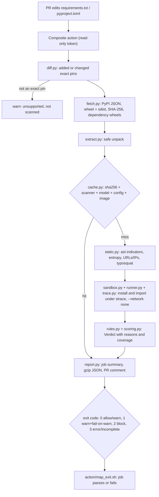

# Build log 00: overview

This is the entry point to the build logs. It explains what pip guard v1 does end to end, the concepts you need to follow it, the major design decisions, and the questions an interviewer is most likely to ask. The other logs (index at the bottom) go module by module.

Scope is PRD v0.2 (`docs/PRD.md`). Where this log describes behaviour, it describes the code as it is in this commit, with `path:line` references.

## Status at the time of writing

Done and verified locally:

- 502 unit tests pass (`uv run pytest`, no network, no Docker).
- The 15 Docker-marked tests pass locally (`uv run pytest -m docker`): the behavioural fixture suite, attribution, timeout, import failure and container cleanup.
- The week-1 spike passed locally under the hardened flags (Docker Desktop 27.5.1 on WSL2; see `docs/DESIGN.md`, "Week-1 spike").
- A local end-to-end `pipguard ci` run on the demo produced `block` for `requets` (credential read plus subprocess/connect, typosquat of `requests`, raw IP), `incomplete:timeout` for `sleepy`, `warn` for `flask>=3`, and exit code 3.
- `pipguard scan six==1.17.0` returned `allow` in 21 s with the sandbox; `six==99.0.0` returned `error` (exit 3) in 3 s.

Not done yet, so no numbers exist for them:

- Track A evaluation (static classifier on the real-world corpus) has **not** been run. `docs/EVAL.md` is a template. There is no trained model; scoring runs rules-only.
- The demo repository has **not** been pushed, so the Track C PRs do not exist on GitHub.
- CI (`.github/workflows/ci.yml`) has **not** run on GitHub yet, so the spike has not been confirmed on `ubuntu-latest`.

## What happens when a PR changes `requirements.txt`

Step by step, for one PR that adds `requets==2.31.0`:

1. **Trigger.** The consuming repo's workflow runs on `pull_request` (never `pull_request_target`) with `permissions: contents: read`. It checks out with `fetch-depth: 0` so the base commit exists, then calls the composite action (`action/action.yml`).
2. **Install the scanner.** The action runs `uv sync --locked --no-default-groups` against its own checkout (`action/action.yml:64`), so pip guard's dependencies come from the hash-pinned `uv.lock`. It builds the sandbox image from `sandbox/sandbox.Dockerfile` (`action/action.yml:76`) and restores the SQLite cache file.
3. **Diff.** `pipguard ci --base <sha>` reads `requirements.txt` and `pyproject.toml` at the base and head refs with `git show` (`src/pipguard/diff.py:178`) and lists every requirement that was added or whose pin changed (`diff.py:146`). Anything that is not `name==version` (a range, a URL, an extra, a marker) becomes an `unsupported` change and later a `warn` verdict that says why (`scoring.py:279`).
4. **Fetch.** For each pin, `fetch.py` asks the PyPI JSON API for that exact release, picks the wheel the *sandbox* can install (CPython 3.12, linux x86_64, glibc 2.36) and the sdist, streams both to disk with a 100 MB cap, and checks each file's SHA-256 against the digest PyPI published (`fetch.py:118`). It reads `Requires-Dist` from the wheel's METADATA without extracting it and downloads wheels for the dependency closure (`fetch.py:520`). Any failure is a `FetchError` and becomes an `error` verdict.
5. **Extract.** `extract.py` unpacks each artifact after checking every entry: no path outside the destination, no links or device files, at most 20,000 entries and 500 MB extracted (`extract.py:30-104`). Nothing is executed.
6. **Cache lookup.** The key is (artifact SHA-256, scanner version, model version, config hash, sandbox image digest) (`pipeline.py:155`). A hit returns the stored verdict and skips static, sandbox and scoring. Only `allow`/`warn`/`block` are ever cached.
7. **Static analysis.** `static.py` parses every `.py` file with `ast` (it never imports or runs them) and records indicators: install hooks, `.pth` import lines, `exec`/`eval`/`b64decode` counts, high-entropy strings, URLs and raw IPs, risky top-level imports, and the typosquat distance to a frozen list of the top 5,000 PyPI names. For `requets` it finds distance 1 to `requests` (rank 8) and the literal `203.0.113.50`.
8. **Sandbox.** `sandbox.py` sends the target wheel and its dependency wheels as a tar on stdin into a container with no network, a read-only root, no capabilities and a non-root user. Inside, `sandbox/runner.py` installs the dependencies untraced, then installs the target with `--no-deps` and imports it, both under `strace`. The trace comes back in one length-prefixed envelope on stdout, and `trace.py` parses it defensively into a `BehaviorTrace`. For `requets` the import step shows an `openat` of `~/.aws/credentials`, an `execve` of `sh -c "curl --version"` and a `connect()` to `203.0.113.50:443`.
9. **Score.** `rules.py` evaluates `rules.yaml` against a flat feature vector. Blocking rules force `block`, warning rules force at least `warn`. `scoring.py` adds the (optional) model score, applies the allowlist, and turns any incomplete trace into `incomplete` unless the level is already `block` (`scoring.py:182-254`). Every non-`allow` verdict must carry a reason; the pydantic model refuses to construct one without (`models.py:389-394`).
10. **Report.** `report.py` writes the job summary (a table with package, artifact, verdict, coverage and the top three reasons), a gzip JSON report with traces for non-`allow` verdicts, and a PR comment body. Every untrusted string is escaped once, here (`report.py:50`).
11. **Exit code.** `report.exit_code` returns 3 if any verdict is `error`/`incomplete`, else 2 for `block`, else 1 for `warn` with `--fail-on-warn`, else 0 (`report.py:38`). The action captures the code and `action/map_exit.sh` turns it into the job outcome; any code other than 0 (including an empty one) fails the job.

## Primer: the concepts behind each step

### Wheels, sdists, and why install-time code differs

A Python package is published to PyPI in up to two forms.

- A **wheel** (`.whl`) is a zip of files that are already laid out for installation, plus a `.dist-info` folder with `METADATA`, `RECORD` and often `top_level.txt`. Installing a wheel means unzipping it into `site-packages` and writing `RECORD`. **No package code runs during a wheel install.**
- An **sdist** (`.tar.gz`) is source. To install it, pip runs the project's build backend (PEP 517), and for setuptools projects that means executing `setup.py`. A malicious `setup.py` (for example one that overrides the `install` command via `cmdclass`) runs at install time.

pip guard installs only wheels in the sandbox and inspects sdists statically. So a `setup.py` hook is reported as *present*, never as *executed*, and every verdict for a package with an sdist lists "sdist build-backend behaviour (not exercised)" under `not_evaluated` (`scoring.py:54`, `scoring.py:160`). This is also why behaviour almost always appears in the **import** step, not the install step: a Docker test asserts that a real `pip install` of a wheel produces zero connects, subprocesses, outside writes and credential reads (`tests/test_behaviour_fixtures.py:145`).

### `.pth` files

When Python starts, the `site` module reads every `*.pth` file in each site directory. Lines are added to `sys.path`, except a line that begins with `import ` or `import\t`, which is **executed**. A package can therefore ship a `.pth` file that runs code on every Python start-up, without anyone importing the package. Static analysis flags such lines (`static.py:564`). In the sandbox, the import step calls `site.addsitedir('/sandbox/site-packages')` so the target's `.pth` files run as they would in a real environment, while the dependency directory is only appended to `sys.path`, so dependency `.pth` files do not run (`sandbox/runner.py:73-84`).

### What strace sees and cannot see

`strace` uses the `ptrace` system call to stop a process at every system call and print it. pip guard runs `strace -f -qq -s 256 -e trace=network,process,file` (`sandbox/runner.py:53`): follow forks (`-f`), quiet (`-qq`), print up to 256 bytes of each string (`-s 256`), and only network, process and file system calls.

It sees: `openat`/`open`/`creat` with path and flags (so reads of credential files and attempts to write outside allowed directories), `execve` with argv (subprocesses), and `connect()` with the address family, IP and port.

It cannot see: environment-variable reads (`os.environ` is memory the process already has, no system call), and DNS names (with no network, there is no resolver traffic, and `getaddrinfo` for a name never reaches a `connect()` with that name in it). The `BehaviorTrace` schema contains only what strace can see (`models.py:263-282`), and every verdict lists the two blind spots in `not_evaluated` (`scoring.py:49-52`).

### Docker isolation flags and what each buys

The full command is built in one function, `sandbox.docker_run_argv` (`src/pipguard/sandbox.py:59-78`):

| Flag | What it buys |
| --- | --- |
| `--rm`, `--name pipguard-<uuid>`, plus `docker rm -f` in a `finally` | The container is destroyed after every run, even on timeout. |
| `-i` with a tar on stdin | Artifacts go in without a bind mount; the host filesystem is never visible. |
| `--network none` | Only a loopback interface. No packet can leave; any `connect()` to an external IP fails, and the attempt is the signal. |
| `--read-only` | The root filesystem cannot be modified; a write anywhere outside the tmpfs mounts fails with EROFS and shows up as an attempt. |
| `--tmpfs /tmp`, `/sandbox/site-packages`, `/sandbox/deps`, `/home/sandbox/.cache` | The only writable places, in memory, size-capped, and `noexec` by Docker's default. |
| `--cap-drop ALL` | No Linux capabilities: no raw sockets, no mount, no `chown` of other users' files, no ptrace of other users. |
| `--security-opt no-new-privileges` | setuid binaries cannot raise privileges. |
| `--security-opt seccomp=sandbox/seccomp-default.json` | Docker's default system-call filter, passed explicitly (see below). |
| `--memory 1g`, `--pids-limit 256` | A fork bomb or memory bomb hits a limit instead of the runner. |
| `--user 10001:10001` | Not root inside the container. |

No Docker socket is mounted and no environment variables are passed in, so the package cannot reach the host's Docker or the CI secrets.

### seccomp

seccomp is a Linux kernel feature that filters which system calls a process may make. Docker applies a default profile that blocks roughly 40 dangerous calls (for example `kexec_load`, `mount`, `bpf`). The open question for week 1 was whether `strace` (which needs `ptrace`) works under it with no capabilities. It does: on recent kernels the default profile allows `ptrace`, and a process may trace its own children without `CAP_SYS_PTRACE`.

The spike also found that Docker Desktop's `docker info` reported `seccomp profile=unconfined`. So the profile is not left to the daemon: the repo carries moby v27.5.1's default profile and passes it on every run. That can only tighten isolation, never loosen it.

### Why `--network none` makes `connect()` a signal

In a normal environment, a library might connect to a server for legitimate reasons. In the sandbox, nothing is reachable, and the run is install-and-import of one package with no user code. So any attempt to connect to an external IP is behaviour the package chose to perform at install or import time. strace records the `connect()` call with its destination even though it fails with `ENETUNREACH`. Without DNS, a package that connects by hostname never reaches `connect()` (resolution fails first), which is a stated limitation.

### Fail-closed CI

A security gate that passes when it breaks is worse than none, because people trust the green check. pip guard maps every failure to a failing check:

- Any scanner exception becomes an `error` verdict (`pipeline.py:245-256`); any sandbox problem becomes an `incomplete:*` trace state (`sandbox.py:248-271`).
- `error` and `incomplete` exit 3, which fails the job (`report.py:38-47`).
- A crash in the CLI itself, and a CLI usage error, exit 3 (`cli.py:198-213`), so click's default usage-error code 2 cannot be confused with `block`.
- The action records the exit code and `map_exit.sh` fails on anything other than exactly 0, including an empty code (`action/map_exit.sh:6-24`).
- The allowlist can lower `block` to `warn`, but it can never turn `incomplete` into a pass (`scoring.py:225-239`).
- The README warns that `continue-on-error: true` on the step defeats all of this.

### The three evaluation tracks

Numbers are reported only for the population they were measured on:

- **Track A, static classification.** Archived real-world malware (Datadog dataset, fetchable OpenSSF subset) versus stratified benign packages, static features only. These samples are never executed. Not yet run.
- **Track B, behavioural detection.** pip guard's own fixture pairs, each suspicious fixture with a benign counterexample using the same API. Run locally as the 15 Docker tests.
- **Track C, end-to-end.** Five demo-repo PRs: planted package, benign bump, unpinned spec, forced timeout, forced download failure. The demo repo has not been pushed; the cases have been run locally with `pipguard ci`.

Behavioural features are never claimed to improve Track A, because Track A samples are never run.

## Major design decisions

| Decision | Why | Alternative rejected |
| --- | --- | --- |
| Analyse the exact artifact by SHA-256, not the name | The verdict must be about the bytes that would be installed; the hash also keys the cache | Name/version lookup in an advisory database (cannot catch unreported attacks) |
| Wheel for dynamic, sdist static-only | A wheel install runs no code, so it is safe and deterministic to install; building an sdist would run arbitrary build code in a much larger attack surface | Building sdists in the sandbox (PRD non-goal; PEP 517 backends need network and time) |
| Docker with hardened flags, `runc`, explicit default seccomp | Available on GitHub runners and every dev machine; spike showed strace works with no relaxation | gVisor (strace interaction unverified), a VM (too slow and not free in Actions), host `venv` (no isolation) |
| `--network none` | Simplest isolation that can be proven; `connect()` destinations stay visible | An internal network with a DNS/TCP sinkhole (deferred: a networking subsystem of its own) |
| Dependencies preinstalled untraced, target `--no-deps`, dependency dir appended to `sys.path` | Behaviour is attributed to the target only; a dependency's `.pth` hook is not blamed on the target | Tracing a full `pip install` (every dependency's behaviour would land on the target) |
| strace to a pipe, runner non-dumpable, package fds moved off the trace | The package runs as the same uid; a trace file in `/tmp` could be rewritten, and `/proc/1/fd/1` could forge the envelope | Trace file in `/tmp` (tamperable), second uid (needs capabilities the container has dropped) |
| One length-prefixed envelope on stdout, strict pydantic validation, 12 MB read cap | Container output is untrusted; a strict schema turns garbage into `incomplete:sandbox_error` | Parsing free-form stdout, or a bind-mounted results dir (FR-4.7 forbids bind mounts) |
| Defensive linear parser with field caps, fuzz-tested | strace output contains attacker-chosen paths and argv; regex backtracking would be a DoS | A general strace parsing library (none in stdlib; adds a dependency with unknown robustness) |
| Rules in YAML with a tiny interpreted condition language | Explainable, testable, no code execution from config | `eval` of Python expressions (a config file becomes code) |
| Blocking vs warning rule classes | A false `block` stops a team's work, so only rules with ≥ 0.95 precision may block | One score threshold for everything (no explanation, no precision guarantee) |
| Model can raise the level, never lower it | A rule hit is direct evidence; a model score is a statistical guess | Letting the model override rules (a low score could hide a credential read) |
| Allowlist caps `block` at `warn`, never hides observations, never passes `incomplete` | Teams need an escape hatch for known-noisy packages without turning off the scanner | Skip allowlisted packages entirely (an allowlisted package hijacked later would pass silently) |
| Every verdict carries `coverage` and `not_evaluated` | A clean result must never be confused with an unexamined one | A bare pass/fail |
| Fail closed everywhere: `error`/`incomplete` exit 3 | A gate that passes when broken creates false trust | Neutral check or pass on scanner error |
| SQLite cache, untrusted on restore, never caches `error`/`incomplete` | Zero infrastructure; a poisoned cache file must not produce `allow` | A hosted shared cache (v2), trusting the restored file |
| Escape untrusted text once, at the Markdown boundary | Reasons stay readable in JSON; escaping twice garbled the summary | Escaping at rule render time (double-escaped output, found during integration) |
| Composite action runs from its own locked checkout | Supply-chain pinning via `uv.lock`; the typosquat snapshot and seccomp profile are repo files | `uv tool install` from PyPI (no lock, no data files) |
| Rules → logistic regression → LightGBM, each only if it wins on held-out data | A few thousand tabular rows: start interpretable, escalate on evidence | A neural or fine-tuned code model (cut in PRD) |
| Logistic regression stored as plain coefficients, scored in pure Python | No scikit-learn at runtime; the artifact is auditable JSON | Pickled scikit-learn model (pickle loading runs code) |
| Popular packages exempt from typosquat | `six` is 2 edits from `pip`; both are top-100, and a benign bump warned | Only excluding the package's own name (false positives on real popular packages) |

## Index of the logs

| Log | Workstream | FR-IDs |
| --- | --- | --- |
| [01-foundation.md](01-foundation.md) | Shared contract, CI, sandbox image, spike | Contracts for all FRs; FR-4.3, FR-4.7 (image side) |
| [02-fetch-extract.md](02-fetch-extract.md) | A: fetch and safe extraction | FR-2.1 to FR-2.5, FR-7.1 `--artifact` |
| [03-static.md](03-static.md) | B: static analysis | FR-3.1 to FR-3.7 |
| [04-sandbox-trace.md](04-sandbox-trace.md) | C: sandbox, runner, trace parser | FR-4.1 to FR-4.7, FR-4.10, FR-4.11 |
| [05-rules-scoring.md](05-rules-scoring.md) | D: rules and scoring | FR-5.1 to FR-5.5, FR-5.8, FR-7.2 |
| [06-diff-cache-report-action.md](06-diff-cache-report-action.md) | E: diff, cache, report, action, CLI | FR-1.1 to FR-1.3, FR-6.1 to FR-6.6, FR-7.1, FR-7.3, FR-7.4 |
| [07-evaluation.md](07-evaluation.md) | F: Track A scaffolding | FR-5.2, FR-5.8, PRD "Data, ML and evaluation" |
| [08-integration-demo.md](08-integration-demo.md) | Merging, integration bugs, demo, Track C | Track C, FR-4.10 policy for PR-proposed wheels |

## Top 15 interview questions

**1. What problem does pip guard solve that pip-audit or Dependabot do not?**
Those tools match a package name and version against a database of reported vulnerabilities or malware, so they only catch an attack after someone has found and reported it. pip guard looks at the artifact itself: static indicators in the files and what the package actually does when it is installed and imported in a sandbox. It complements them; it does not replace CVE scanning.

**2. Walk me through what happens when a PR adds a dependency.**
The action diffs the exact pins between base and head, fetches the wheel and sdist from PyPI and verifies their SHA-256, extracts them safely, and checks the cache. On a miss it runs static analysis, installs and imports the wheel under strace in a network-less container, scores the evidence with rules (plus a model once trained), and writes a job summary and a JSON report. The exit code (0, 1, 2 or 3) is mapped to the job outcome, and `block`, `error` and `incomplete` fail the check.

**3. Why do you only run wheels in the sandbox?**
Installing a wheel is unzipping files, so it is deterministic and runs no package code; the interesting behaviour then shows up at import. Building an sdist runs an arbitrary build backend, often needs the network for build dependencies, and is slow. So sdists are inspected statically (for example for a `cmdclass` hook), and the verdict says that sdist build behaviour was not exercised.

**4. How do you know the behaviour you see belongs to the target and not one of its dependencies?**
The runner installs dependency wheels into a separate directory before tracing starts, then installs only the target with `--no-deps` under strace. During the traced import the dependency directory is appended to `sys.path` rather than added as a site directory, so dependency `.pth` start-up hooks do not run. A Docker test uses a dependency whose `.pth` file connects out and asserts that no connect is attributed to the target.

**5. Is the sandbox escape-proof?**
No, and the README says so. Docker shares the host kernel, so a kernel exploit could escape. The container uses strong defaults (no network, read-only root, no capabilities, no-new-privileges, Docker's default seccomp profile, memory and PID limits, non-root user, no bind mounts or Docker socket), which is appropriate for a CI scanner of packages a PR proposes, not for analysing targeted malware. That is why archived real-world malware is never executed.

**6. What can strace not see, and how does that affect the verdict?**
It cannot see environment-variable reads or DNS names, and with no network a hostname-based connection fails before `connect()`. It also only sees what the package does during install and import, so behaviour triggered by a timer, an input or an environment check is missed. The schema holds only observable things, and every verdict lists the blind spots under `not_evaluated`.

**7. How does the scanner fail closed?**
Every stage failure is converted to an `error` verdict or an `incomplete:*` trace state, and both exit 3, which fails the job. The CLI maps its own crashes and usage errors to 3, the action's mapping script fails on anything other than 0, and the allowlist cannot turn an incomplete scan into a pass. The cache never stores `error` or `incomplete`, so a failure is always retried.

**8. Why treat strace output as untrusted input?**
The package chooses the file paths, argv strings and addresses that strace prints, and since it runs as the same uid it can even write into strace's output pipe. So the parser caps input size, line length and every field, uses only bounded regexes plus a linear argument splitter, never evaluates anything, and is fuzzed with hypothesis. The rendered report escapes everything again at the Markdown boundary.

**9. What stops a malicious package from forging the trace or the result?**
strace writes to a pipe the runner reads rather than a file in `/tmp`, the traced programs move their own stdout and stderr to log files before package code runs, and the runner (PID 1) marks itself non-dumpable so the package cannot open `/proc/1/fd/1`. Residual risks are documented: the package can still write into strace's pipe through `/proc/<strace pid>/fd`, kill strace (which makes the run `incomplete`), or forge its own per-module import results. Fixing those needs a tracer outside the container, which is deferred.

**10. Why rules plus a model, and why can the model never lower the level?**
Rules are explainable and each blocking rule needs measured precision of at least 0.95 on benign packages. The model (logistic regression, if it beats rules on held-out data) can catch combinations that no single rule covers, so it may raise `allow` to `warn` or `block`. It never lowers a rule hit, because a rule hit is direct evidence such as a credential read, and a statistical score should not overrule that.

**11. How is the evaluation designed so the numbers are honest?**
Three tracks that are never mixed: static classification on real-world malware versus stratified benign packages, behavioural detection on fixtures, and end-to-end demo PRs. Track A splits by package name and campaign group so near-identical payloads cannot sit in both train and test, chooses thresholds on a validation fold at a per-band false-positive target, reports recall with 95% Wilson intervals and counts, and states that "benign" is a weak label. Track A has not been run yet, so no numbers are claimed.

**12. What did the week-1 spike establish and what did you find?**
It established that `strace -f` works inside the container with `--cap-drop ALL`, `no-new-privileges`, a read-only root, `--network none`, a non-root user and the default seccomp profile, observing a credential `openat`, an `execve` and a `connect()` to a TEST-NET address. No relaxation was needed. The surprising finding was that Docker Desktop reported seccomp as unconfined, so the default profile is now passed explicitly on every run.

**13. How do you handle a package that has no wheel for the sandbox, or uses compiled extensions?**
With no compatible wheel, only the sdist is fetched and analysed statically, and the sandbox returns `incomplete:no_wheel`, so the check fails closed. Compiled extensions fail to load because Docker's tmpfs is `noexec`, which gives `incomplete:import_failed`. Allowing exec on that tmpfs is recorded as an open decision; it was not taken because it widens what the package can do.

**14. Why does the cache key include the sandbox image digest, and why not cache failures?**
The PRD says a behavioural result may be reused only for the identical artifact and the identical runtime; a changed image (a new strace or Python) could observe different things. Errors and incomplete runs describe a failed scan, not the package, so caching them would either block forever or, worse, hide a package that was never examined. The restored cache file is also treated as hostile: any oddity is a miss.

**15. What would you do next?**
Run Track A and publish `docs/EVAL.md`, push the demo repo and run Track C on GitHub, and confirm the spike on `ubuntu-latest` in CI. After v1, the deferred items are a network sinkhole to capture DNS names and payload prefixes, a tracer outside the container (eBPF) to remove the same-uid tampering risk, gVisor, and lockfile support. Each is a separate project, which is why they were cut from v1.
